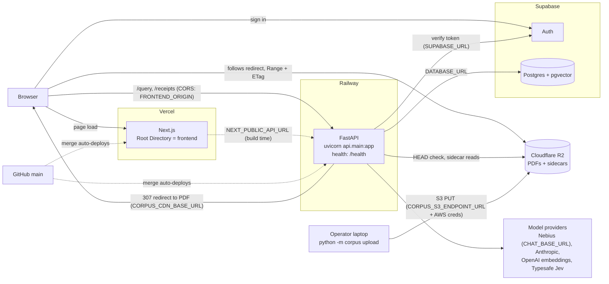

# Deployment

Production runs on four services. Vercel serves the frontend, Railway runs the API, Supabase holds the database and handles sign-in, and Cloudflare R2 stores the receipt PDFs. Merging to `main` deploys Vercel and Railway through their GitHub integrations. Solid arrows below are runtime traffic. Dotted arrows are config or deploy triggers.

- **Vercel** builds the Next.js app in `frontend/`. It serves the page only. The browser calls the API directly.
- **Railway** runs the FastAPI app from `railway.toml`. It needs a long-running process because answers stream over SSE.
- **Supabase** is Postgres with pgvector, and the auth provider. Detail is in [Production database](../CONTRIBUTING.md#production-database).
- **Cloudflare R2** holds the receipt PDFs and highlight sidecars. Only five PDFs are in git, so the rest stay out of the Railway image.

## Service settings

Each service has settings in its dashboard that the repo does not control. Check them by hand.

| Service | Deploys from | Trigger | Dashboard settings that must hold |
|---|---|---|---|
| Railway | This repo, branch `main` | Merge to `main` | Build and start come from `railway.toml`. Health check is `/health` with a 30 second timeout. No release command exists. |
| Vercel | This repo, branch `main` | Merge to `main` | Root Directory is `frontend`. There is no root `vercel.json`, and an earlier root file broke the build ([#182](https://github.com/aishahsofea/ai-legal-tool/issues/182)). |
| Supabase | Not deployed from the repo | None | Add the deployed frontend's `/auth/callback` to the redirect URLs. Steps are in [Sign-in (Supabase Auth)](../CONTRIBUTING.md#sign-in-supabase-auth). |
| Cloudflare R2 | Not deployed from the repo | `python -m corpus upload` from an operator machine | Bucket and custom domain. CORS and retention are set outside the repo. See [Citation Receipt assets and verification](../CONTRIBUTING.md#citation-receipt-assets-and-verification). |

No preview or staging environments exist. GitHub Actions (`.github/workflows/evals.yml`) runs CI only. It does not deploy.

## Variables by service

Names only; each is explained in the [environment variables](../CONTRIBUTING.md#2-environment-variables) tables. The Railway and Vercel lists were compared against the dashboards on 2026-10-13.

**Railway** (API):

- Required by the code: `DATABASE_URL`, `SUPABASE_URL`, `FRONTEND_ORIGIN`, `OPENAI_API_KEY`, `ANTHROPIC_API_KEY`.
- Chat provider: `CHAT_BASE_URL` and `CHAT_API_KEY`. Set both, or `CHAT_API_KEY` is sent to `api.openai.com`.
- Grounding check: `GROUNDING_BASE_URL`, `GROUNDING_API_KEY`, `GROUNDING_MODEL`.
- Models: `ROUTER_MODEL`, `CONTEXTUALIZER_MODEL`, `CONVERSATIONAL_MODEL`, `SYNTHESISER_MODEL`, `RETRIEVAL_AGENT_MODEL`, `MEMORY_EXTRACT_MODEL`.
- Feature flags: `AGENTIC_RETRIEVAL`, `CURRENCY_CHECK_ENABLED`, `WEB_COMMENTARY_ENABLED`. Commentary also needs `COMMENTARY_ALLOWLIST`.
- Receipts: `CORPUS_CDN_BASE_URL` (see [Receipt PDFs on R2](#receipt-pdfs-on-r2)). Optional: `RECEIPT_DELIVERY_MODE`.
- Evals: `EVALS_ADMIN_USER_IDS`.
- Search: `TAVILY_API_KEY`.
- Tracing: `LANGSMITH_TRACING`, `LANGSMITH_API_KEY`, `LANGSMITH_PROJECT`. `LANGCHAIN_TRACING_V2` and `LANGCHAIN_PROJECT` are older LangSmith names the repo does not read.
- Optional, not set today: `EVALS_DATABASE_URL`, `TYPESAFE_API_KEY` and `JEV_MODEL` (Jev).

**Vercel** (frontend): values are built into the page, so changing one in the dashboard needs a redeploy.

- Required: `NEXT_PUBLIC_API_URL`, `NEXT_PUBLIC_SUPABASE_URL`, `NEXT_PUBLIC_SUPABASE_ANON_KEY`.
- Optional, not set today: `NEXT_PUBLIC_EVALS=1` turns on the `/evals` page. Without it the page returns 404.

**Operator machine only** (never set on Railway): `CORPUS_S3_ENDPOINT_URL` and the AWS credentials for `python -m corpus upload`, `TESSDATA_PREFIX`, `DOWNLOAD_CONCURRENCY`.

## Receipt PDFs on R2

The browser asks the API for `GET /receipts/{id}/pdf`. In the default `auto` mode:

- For the five git-tracked PDFs, the API serves the bytes itself.
- For any other document, it checks the R2 object, then answers `307` with an address under `CORPUS_CDN_BASE_URL`. The browser follows the redirect to R2. Without `CORPUS_CDN_BASE_URL`, these documents answer 503.

With `RECEIPT_DELIVERY_MODE=proxy`, the API streams the bytes through Railway instead.

The API reads highlight sidecars from R2. The browser never fetches them. CORS, retention and the boot report are in [Citation Receipt assets and verification](../CONTRIBUTING.md#citation-receipt-assets-and-verification).

## Which database production reads

Production reads the database in Railway's `DATABASE_URL`. Your local `.env` points at a different one. A load, a migration or a `psql` command run against the local value does not touch production. Disk, plan and index details are in [Production database](../CONTRIBUTING.md#production-database).

The API applies `migrations/0002_threads.sql` on every start. If the database is down, the API still starts, but requests fail with a 500. The browser reports that 500 as a CORS error. See [3. Database schema](../CONTRIBUTING.md#3-database-schema).
